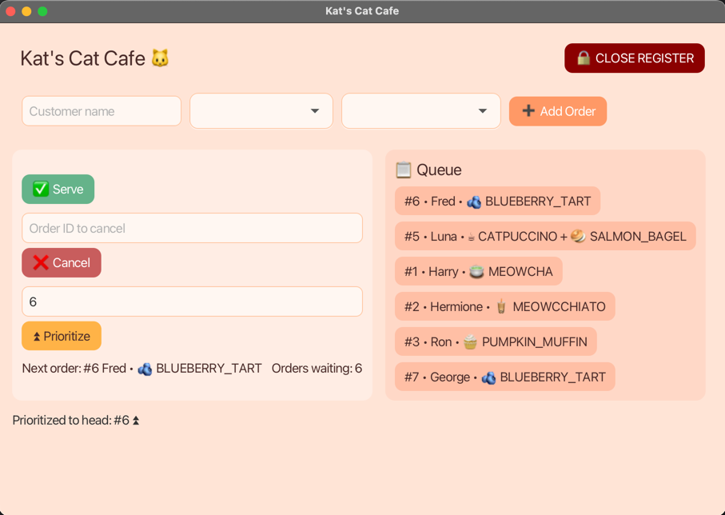
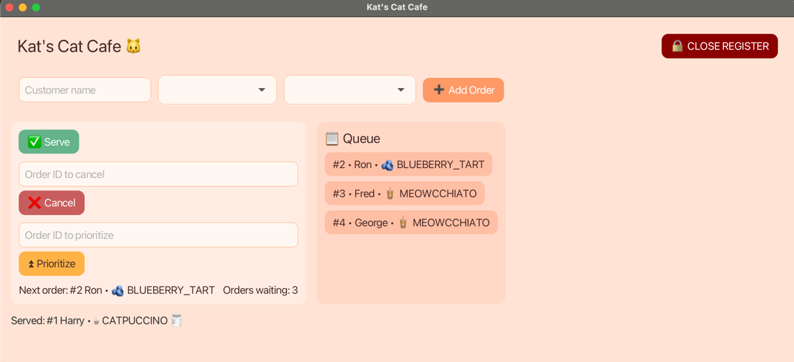
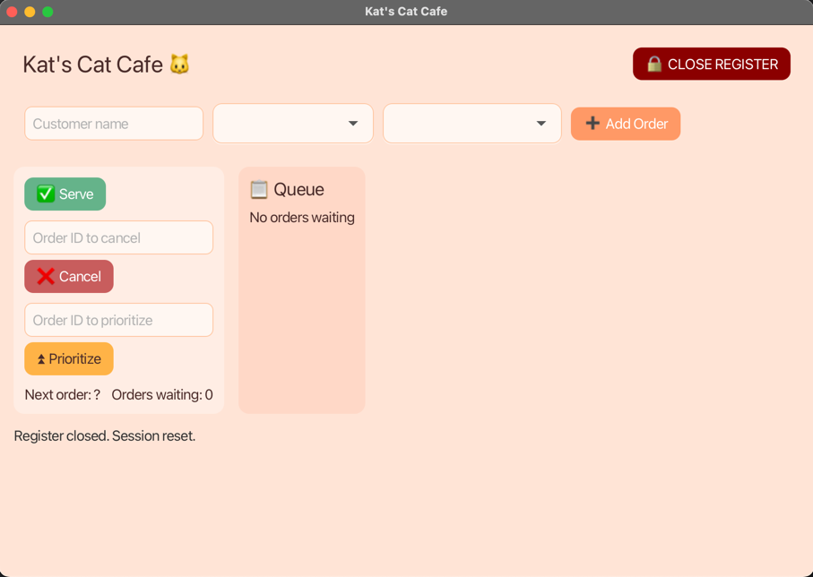

# G30-F25-A2

## Assignment 2 – 😸Kat’s Cat Cafe☕

Date assigned: Oct 8, 2025  
Due date: Oct 27, 2025 EOD (11:59PM)

## Learning Objectives
Upon successful completion of this assignment, the student will be able to:

1. Design and implement an MVP architecture in a JavaFX application
2. Use a `LinkedList` as the backing structure for an application
3. Write JUnit tests for business logic and flow

**Marking Scheme**

| Question                    | Mark |
|-----------------------------|------|
| Class Diagram               | 5    |
| Unit tests                  | 20   |
| Backing structure           | 10   |
| Add order                   | 8    |
| Serve order                 | 5    |
| Prioritize order            | 8    |
| Next order & orders count   | 6    |
| Close register              | 6    |
| UI feedback & event updates | 6    |
| UI usability                | 6    |
| Robustness, architecture    | 10   |
| Kotlin language standards   | 5    |
| Git commit etiquette        | 5    |
| Total                       | 100  |

## Setup & submission
- READ THE ENTIRE ASSIGNMENT FIRST before starting, so you understand all requirements and the breakdown.
- A starter project will be provided in the repository for you. Add new Kotlin files and test files as needed.
- Commit often: `git add .`, `git commit -m "message"`, and push: `git push origin main`.
- After the deadline, Kat will comment with your specific feedback and overall grade on the Feedback Pull Request

## Problem Specification
### Description
You are designing and building a simulation of a coffee shop/bakery called "Kat's Cat Cafe". The cafe takes orders, prepares them, and serves them.

### Functionality
1. You must keep track of all customer orders throughout the day at Kat's Cat Cafe.
2. The Orders Queue displays all current orders waiting to be prepared and served. Every order should display the auto-incrementing ID, the customer name, and what they ordered.
3. Any time "Close register" is pressed, the orders queue is cleared, and the state of the application is reset.
4. Pressing "Add order" will add a new order to the Orders Queue, which consists of a customer name, and at least 1 food/drink item.
5. Pressing "Serve" will remove the first order from the Orders Queue. Note: do NOT re-shift the IDs. If you have orders 1, 2, 3 in the queue, and serve #1, the updated Orders Queue would be 2, 3.
6. Pressing "Cancel" after specifying an ID will remove that order from the Orders Queue. Note: do NOT re-shift the IDs. If you have orders 1, 2, 3 in the queue, and cancel #2, the updated Orders Queue would be 1, 3.
7. Pressing "Prioritize" after specifying an ID will move that order to the head (first order). If you have orders 1,2,3 and prioritize #3, the Orders Queue would be 3, 1, 2.
8. Any time the Orders Queue is updated, you must notify the user of the action that happened.
9. Any time the Orders Queue is updated, you must update the count of # of orders waiting.
10. Any time the Orders Queue is updated, you must show the "Next order" so it is obvious to the user which order will be served next.

## Building Kat's Cat Cafe
In addition to all the functionality described in the Problem Spec above, ensure your application meets the following requirements:

### Technical requirements
- Your model must use a `LinkedList<Order>` for its backing structure (use java.util.LinkedList, do NOT make your own).
- I have provided you with a data class for `Order`. You may add to this if you choose, but do NOT remove any properties.
- I have provided you with a set menu for Drinks and Food. You must use these enums to populate 2 dropdowns which will represent the customer's order choices. An order must contain at least 1 food or drink item.
- Use a `TextField` for the customer Name, and 2 `ComboBox` for the drink and food choices. For these as well as other buttons, labels, and inputs, you have creative freedom for how you'd like to design it.

### Reminders & tips
- You are building a GUI for Kat's Cat Cafe using programmatic JavaFX. There will be NO use of FXML.
- There are marks in the rubric for usability. You must give feedback to the user (updating a label, disabling buttons, etc.) when they interact with your UI.
- Remember to think about robustness & architecture. Look at the rubric for mark breakdown.
- You must unit test all your business logic and flow. Remember your boundaries, equivalences, edge cases. You do not have to create UI tests (we did not learn how to make UI tests).
- Look below at example UI for the application. Although I am calling it an orders "Queue", note that it does not behave like a true Queue (ex. you can do removals in the middle of the collection).

### Example UI for Kat's Cat Cafe
NOTE that you do not have to copy my UI. As long as you have all required functionality, you can design your UI however you like (note the marks for in rubric for usability). If you feel uninspired, you may use mine for inspiration.

**Orders queue after multiple adds, #5 prioritized, #4 cancelled, and then #6 prioritized:**

**Orders queue after multiple adds, and first order served (#1 Harry):**  

**Empty orders queue after closed register:**   

### Good luck!! 💫
